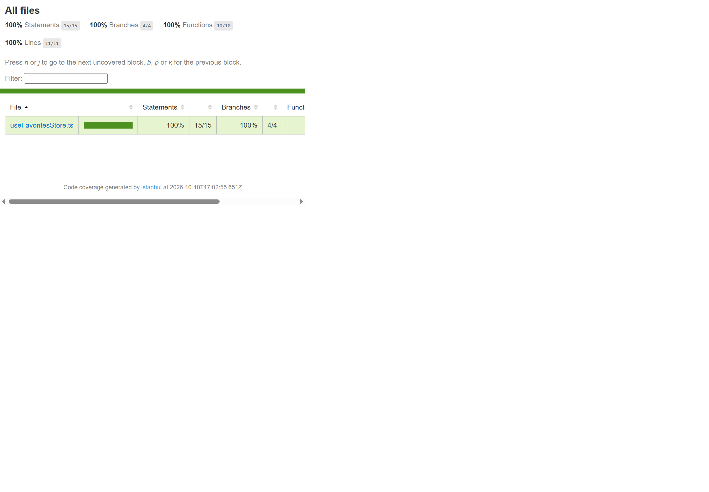

# BÁO CÁO BÀI TẬP TUẦN 6 – KIỂM THỬ FRONTEND

> **Lưu ý:** Đây là báo cáo lịch sử cho phiên bản React + Vite của bài tập tuần 6. Dự án hiện đã chuyển sang Next.js cho bài tập tuần 8; kết quả kiểm thử mới nhất nằm tại [docs/testing-report.md](./docs/testing-report.md), còn so sánh Lighthouse tại [docs/performance-report.md](./docs/performance-report.md).

## 1. Thông tin bài tập

| Nội dung | Thông tin |
|---|---|
| Tên bài tập | Bài tập tuần 6 – Kiểm thử Frontend |
| Môn học | Lập trình Web nâng cao |
| Sinh viên | ........................................................ |
| Lớp | ........................................................ |
| Công nghệ | React 19, TypeScript, Vite, Jest, React Testing Library, Zustand |

## 2. Mục tiêu kiểm thử

Kiểm thử giúp xác minh logic nghiệp vụ của danh sách yêu thích, hành vi người dùng trên giao diện và cách xử lý kết quả API bất đồng bộ. Bài tập đặt ra các mục tiêu:

- Có tối thiểu 10 test case.
- Bao gồm Unit Testing và Integration Testing.
- Có kiểm thử bất đồng bộ với API được mock.
- Đạt coverage tối thiểu 70% cho module được chọn ở statements, branches, functions và lines.

## 3. Tổng quan chức năng được kiểm thử

Ứng dụng hiện có giao diện danh mục bốn sản phẩm với tên, danh mục và giá; người dùng có thể thêm hoặc bỏ yêu thích. Danh sách yêu thích được lưu trong Zustand, hiển thị số lượng, trạng thái rỗng và các sản phẩm đã chọn. Mỗi sản phẩm được nhận diện bằng `id`; store không thêm bản ghi trùng ID.

Module được chọn để đo coverage là `src/stores/useFavoritesStore.ts`, vì đây là nơi triển khai trực tiếp các thao tác nghiệp vụ chính: thêm, xóa, kiểm tra tồn tại và toggle sản phẩm yêu thích.

Source hiện không có API service cho danh mục sản phẩm: danh sách hiển thị đang được khai báo tĩnh trong `src/App.tsx`. Để đáp ứng phần kiểm thử API bất đồng bộ, đã tạo `src/services/productsApi.ts` như một service độc lập, có thể nhận hàm fetcher để mock. Service này **chưa được tích hợp vào giao diện** và các test API không gọi backend thật.

## 4. Môi trường và công cụ kiểm thử

| Thành phần | Phiên bản/cấu hình |
|---|---|
| Node.js | v24.20.0 |
| npm | 11.19.0 |
| React | `^19.2.8` (khai báo trong `package.json`) |
| Jest | `^29.7.0` |
| ts-jest | `^29.4.14` |
| jest-environment-jsdom | `^29.7.0` |
| React Testing Library | `^16.3.3` |
| jest-dom | `^7.0.1` |
| user-event | `^14.6.7` |

Cấu hình tại `jest.config.cjs` sử dụng môi trường `jsdom`, nhận diện file test `.test.ts` và `.test.tsx`, dùng `ts-jest` để chuyển đổi TypeScript/JSX, nạp `src/testSetup.ts` và mock import CSS. Báo cáo coverage xuất ra định dạng terminal, HTML và lcov trong thư mục `coverage/`. Ngưỡng 70% được áp dụng riêng cho `src/stores/useFavoritesStore.ts`, không phải toàn bộ project.

Các script kiểm thử trong `package.json`:

- `npm test`: chạy Jest.
- `npm run test:coverage`: chạy Jest và thu thập coverage.

## 5. Phương pháp kiểm thử

- **Unit Testing:** kiểm tra trực tiếp các hành động và trạng thái của Zustand store, không phụ thuộc giao diện.
- **Integration Testing:** render `App` bằng React Testing Library để kiểm tra danh mục, panel yêu thích và sự đồng bộ giao diện với store.
- **Kiểm thử tương tác người dùng:** dùng `userEvent` mô phỏng nhấn nút thêm/bỏ yêu thích, sau đó xác minh giao diện và trạng thái store.
- **Kiểm thử bất đồng bộ với API mock:** truyền fetcher giả lập vào `fetchProducts` để kiểm tra phản hồi thành công, lỗi HTTP và dữ liệu không đúng định dạng danh sách. Không có request tới backend thật.
- **Kiểm thử trường hợp biên:** kiểm tra ID trùng, xóa ID không tồn tại, danh sách rỗng và phản hồi API không phải mảng.

## 6. Danh sách test case

Kết quả dưới đây căn cứ vào lần chạy coverage gần nhất: **16 test pass, 0 fail**.

| Mã test | Loại kiểm thử | Chức năng/trường hợp | Kết quả mong đợi | Kết quả thực tế |
|---|---|---|---|---|
| UT01 | Unit | Khởi tạo danh sách yêu thích | Danh sách ban đầu rỗng | PASS |
| UT02 | Unit | Thêm một sản phẩm yêu thích | Sản phẩm được thêm vào store | PASS |
| UT03 | Unit – biên | Thêm lại sản phẩm có cùng ID | Không tạo bản ghi trùng | PASS |
| UT04 | Unit | Xóa một sản phẩm trong danh sách nhiều sản phẩm | Sản phẩm mục tiêu bị xóa, sản phẩm khác được giữ lại | PASS |
| UT05 | Unit – biên | Xóa ID không tồn tại | Danh sách không thay đổi | PASS |
| UT06 | Unit | Kiểm tra sản phẩm có/không có trong danh sách | `isFavorite` trả về đúng trạng thái | PASS |
| UT07 | Unit | Toggle sản phẩm chưa yêu thích | Sản phẩm được thêm vào store | PASS |
| UT08 | Unit | Toggle sản phẩm đã yêu thích | Sản phẩm bị xóa khỏi store | PASS |
| IT01 | Integration | Hiển thị danh mục sản phẩm | Hiển thị đủ bốn sản phẩm và giá sản phẩm đầu tiên | PASS |
| IT02 | Integration | Trạng thái yêu thích ban đầu | Hiện thông báo danh sách rỗng và số lượng 0 | PASS |
| IT03 | Integration – tương tác | Nhấn nút thêm yêu thích | Nút, panel và Zustand store phản ánh sản phẩm đã lưu | PASS |
| IT04 | Integration – tương tác | Bỏ yêu thích từ danh sách | Sản phẩm bị xóa, giao diện trở về trạng thái rỗng | PASS |
| IT05 | Integration – tương tác/biên | Xóa một trong hai sản phẩm yêu thích | Số lượng còn 1, sản phẩm còn lại vẫn hiển thị | PASS |
| API01 | API bất đồng bộ | API trả về danh sách thành công | Promise trả về đúng danh sách và gọi endpoint `/api/products` | PASS |
| API02 | API bất đồng bộ – lỗi | API trả HTTP 503 | Promise reject với thông báo lỗi HTTP phù hợp | PASS |
| API03 | API bất đồng bộ – dữ liệu biên | API trả dữ liệu không phải mảng | Promise reject với thông báo dữ liệu không hợp lệ | PASS |

## 7. Kết quả thực thi kiểm thử

- **Tổng số test case:** 16.
- **PASS:** 16.
- **FAIL:** 0.
- **Bỏ qua:** 0.
- **Lệnh coverage đã chạy:** `npm run test:coverage`.
- **Lệnh chạy test thông thường:** `npm test`.
- **Kết quả suite gần nhất:** 3 test suites passed; 16 tests passed; 0 snapshots.

Trong quá trình thiết lập, một số test ban đầu cần điều chỉnh do matcher Jest DOM chưa được nhận diện trong TypeScript, giá tiền định dạng có khoảng trắng không ngắt dòng, và cùng tên nút xuất hiện ở cả danh mục lẫn panel yêu thích. Đã cập nhật setup/import matcher và giới hạn truy vấn trong đúng vùng giao diện. Đây là vấn đề của cấu hình/test, không phải lỗi chức năng ứng dụng. Lần chạy cuối cùng đều thành công.

Kiểm tra bổ sung sau khi thêm test: `npm run build` thành công và `npm run lint` thành công.

## 8. Kết quả Coverage

Coverage được đo cho module **`src/stores/useFavoritesStore.ts`**. Đây không phải tỷ lệ coverage của toàn bộ ứng dụng.

| Chỉ số | Tỷ lệ thực tế | Yêu cầu | Đánh giá |
|---|---:|---:|---|
| Statements | 100% | ≥ 70% | Đạt |
| Branches | 100% | ≥ 70% | Đạt |
| Functions | 100% | ≥ 70% | Đạt |
| Lines | 100% | ≥ 70% | Đạt |

## 9. Hình ảnh minh chứng

Ảnh được sắp theo thứ tự capture 01, 02, 03. Capture 03 là ảnh báo cáo Coverage HTML đã chụp từ trình duyệt. Capture 01 và 02 chưa có ảnh chụp; bổ sung hai ảnh này sau khi chụp kết quả test và coverage trên terminal.

- **Hình 1. Kết quả chạy toàn bộ test (capture 01):** [Bổ sung ảnh sau](screenshots/capture-01-test-results.png)
- **Hình 2. Báo cáo Coverage trên Terminal (capture 02):** [Bổ sung ảnh sau](screenshots/capture-02-coverage-terminal.png)
- **Hình 3. Báo cáo Coverage HTML (capture 03):**

  

## 10. Hướng dẫn chạy lại

Mở terminal tại thư mục gốc project, cùng cấp với `package.json`, rồi chạy:

```sh
npm install
npm test
npm run test:coverage
```

Sau khi lệnh coverage hoàn tất, mở file `coverage/lcov-report/index.html` trong trình duyệt để xem báo cáo HTML. Thư mục `coverage/` được Git bỏ qua và sẽ được tạo lại khi chạy coverage.

## 11. Đánh giá và kết luận

Đã kiểm thử logic store, danh mục sản phẩm, các tương tác thêm/bỏ yêu thích và ba nhánh kết quả của service API bất đồng bộ dùng mock. Lần chạy coverage gần nhất xác nhận 16/16 test pass; module Zustand đạt 100% ở cả bốn chỉ số coverage, vượt ngưỡng 70%. Lệnh build và lint cũng thành công.

Các kết quả trên đáp ứng yêu cầu về số lượng test, Unit Testing, Integration Testing, API mock bất đồng bộ và coverage cho module được chọn. Tuy nhiên, API service chỉ là ví dụ độc lập, chưa kết nối backend hoặc luồng tải sản phẩm trên giao diện; bài kiểm thử cũng chưa xác minh tích hợp với API thật. Vì vậy, kết luận chỉ áp dụng cho các hành vi và module đã nêu, không khẳng định đã kiểm thử toàn bộ ứng dụng hoặc backend.

Hướng cải thiện tiếp theo là tích hợp API thật khi có backend/hợp đồng API, bổ sung kiểm thử cho luồng loading/error trên giao diện sau khi tích hợp, và mở rộng coverage sang các module khác nếu phạm vi bài tập yêu cầu.
